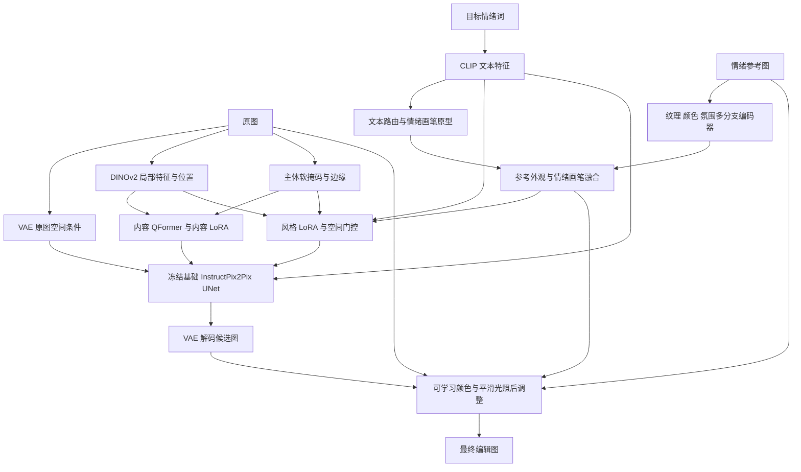

# EmotionBrush：参考图条件情感图像编辑

维护与发布署名：**bashuihean**。

**状态：公开源码，暂不授予开源许可证。** 使用权限见 [COPYRIGHT.md](COPYRIGHT.md)。
本仓库公开当前完整模型实现及必要共享编码器，不附带客户数据、训练权重、私有环境或连接信息。

**权重发布进度：** 已计划公开最终训练参数及配套文件，沿用本仓库权限说明。当前检查点仍在原训练服务器，尚未取回或上传，因此暂时没有模型下载链接。客户数据不随权重发布。

## 项目做什么

输入原图、情绪参考图、目标情绪词，输出保留原图主体和构图、改变颜色、纹理与氛围的图像。
参考图是外观条件，**不是配对的标准答案**。当前模型不输入 caption 或模板编辑指令。
支持 amusement、awe、contentment、excitement、anger、disgust、fear、sadness。

## 结构



内容分支先训练，正式编辑阶段冻结；外观编码、情绪原型、风格 LoRA、空间门控和颜色光照模块学习外观变化。
颜色光照模块位于 VAE 解码后，与编辑模块联合优化；它按原位置调整颜色亮度，不预测位移。
主体保护是软约束，不能保证整个扩散模型绝不改变形状。

## 技术贡献与公开原因

见 [技术贡献说明](docs/CONTRIBUTIONS.md) 与 [公开说明](docs/RELEASE_STATEMENT.md)。
本项目的贡献是具体的模块组合、训练边界和工程实现，不宣称发明 DINOv2、QFormer、LoRA 或扩散模型。

## 安装与训练

以 Python 3.10、Linux、两张支持 BF16 的 NVIDIA GPU 为原训练环境。
从仓库根目录运行，先安装适合驱动的 PyTorch，再安装 requirements.txt；记录版本不代表全部硬件均已测试。

```bash
pip install -r requirements.txt
cp configs/train.example.json configs/train.json
```

自行依相应许可证取得 InstructPix2Pix、DINOv2-small、CLIP 和 BiRefNet_lite 资产，配置为本地目录。
`assets` 命令下载 ResNet 骨干和 BiRefNet，不负责下载所有基础模型。
BiRefNet 使用 trust_remote_code，请检查并固定其模型代码与依赖。

**兼容限制：现有历史 ESMI/验证路径仍要求配置 legacy_esmi_weights，即兼容的 8 类旧分类器权重。**
该权重未公开；不具备该权重时，完整历史验证/训练流水线尚不能直接复现。
不能用随机权重顶替并将结果称为原指标。代码公开不等于本仓库已提供完整可复现实验资产。

按 examples/manifest.example.json 准备 train/val/test JSON；每行 image、reference_image、target_emotion。
自行按原始图像身份及重复图分组划分，避免同源图跨集合；内置 audit 只检查路径交集，不能检出所有近重复。
参考图不能放到 target_image 字段中当成配对监督。所有路径相对运行目录。

准备好资产与兼容旧分类器后：

```bash
CUDA_VISIBLE_DEVICES=0,1 python -m emotion_diffusion.reference_v19.pipeline --config configs/train.json
```

依次运行：资产准备 → 冻结特征 NPZ → A/B 分类器 → 情绪画笔预学习 → 内容预训练 → 编辑训练。
NPZ 缓存冻结的 VAE、DINO、分割和分类器骨干特征；可训练外观编码器仍在线运行。
分类器 A 用于生成器情绪监督；分类器 B 固定用于新 Emo-A，不能随生成器同步更新。
两卡、每卡 batch 1、梯度累积 4，对应有效 batch 8。DDP 训练用 torchrun/NCCL，建议 Linux。
新流水线从头搭建适配器；历史最终结果则来自已有内容权重和前代编辑权重热启动，二者不可当成完全相同的运行。

## 推理

```bash
python -m emotion_diffusion.reference_v19.infer --config configs/train.json --checkpoint outputs/run/edit_latest.pt --source data/source.png --reference data/reference.png --emotion sadness --output outputs/example.png --steps 20
```

须先有匹配模型、分类器 A、文本缓存与编辑检查点。本仓库不发布训练权重。
训练扩散时间轴为 1000；采样配置 20 与编辑强度 0.55 时，实际执行约 11 次 UNet 去噪调用。

## 评测与限制

见 [指标与历史结果](docs/EVALUATION.md)。新 Emo-A 指固定分类器 B 对生成图的目标情绪分类准确率。
SSIM、CLIP-I、DINO 反映不同层面的原图相似性；不能单独代表美观或指令完成程度。
旧 ESMI 是兼容实现，不应将其数值解释为主体保留百分比。
私有测试数据、参考图、结果拼图和权重不随仓库发布。

## 文件

- emotion_diffusion/reference_v19：模型、损失、缓存、训练、推理、指标与诊断完整实现。
- emotion_diffusion/spatial_model.py：当前使用的共享 DINO 编码器。
- configs、examples：去除私有路径的配置和数据格式。
- docs：技术贡献、公开缘由、指标口径、来源与复现限制。
- SOURCE_MANIFEST.json：本次公开文件 SHA256，不含该清单自身。

参考与权利边界见 [THIRD_PARTY.md](THIRD_PARTY.md)。引用仓库应记录版本或提交号；引用不替代使用授权。
